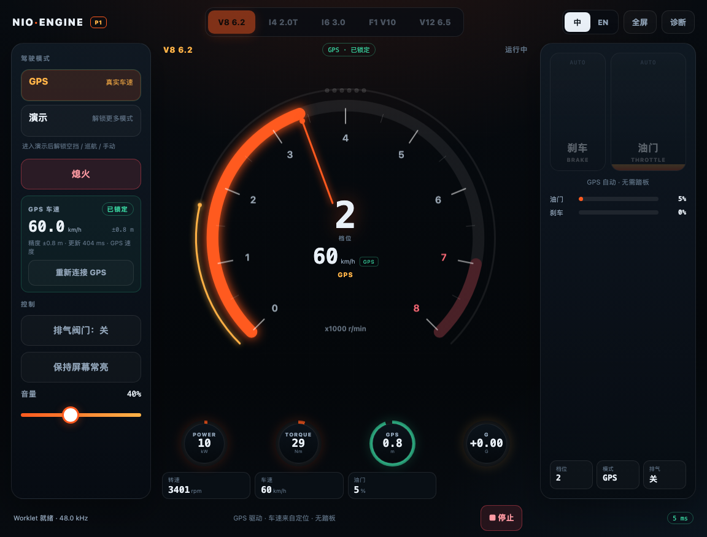
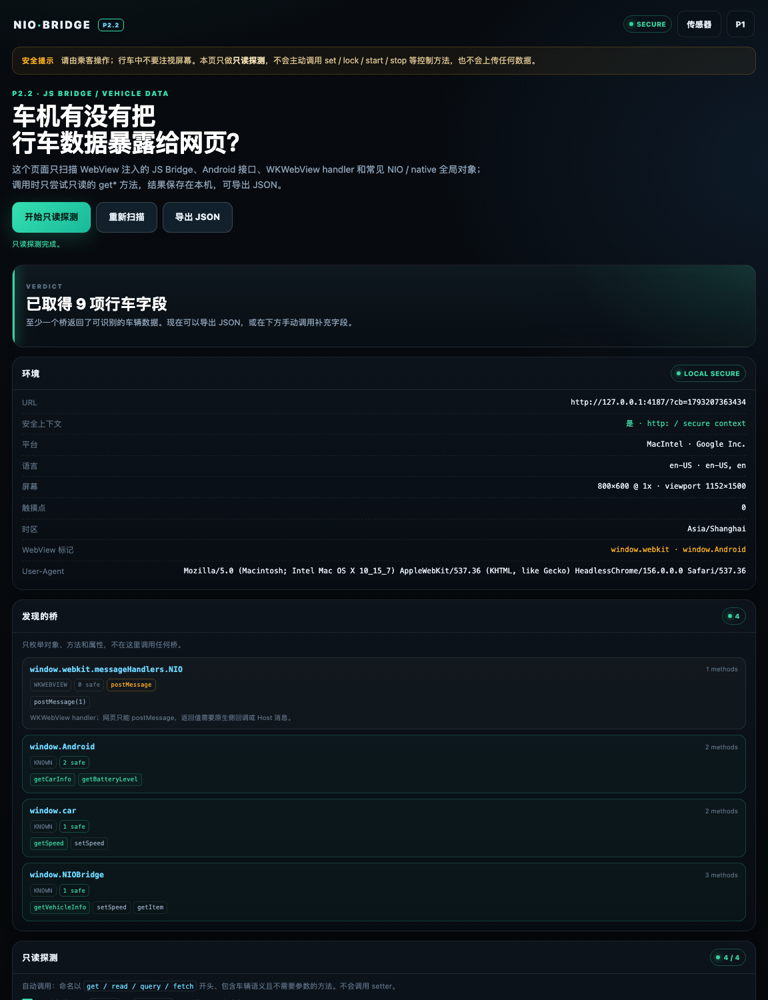

# nioengine · 车机模拟声浪

仓库包含四个单文件车机 Web 应用：

- **P1 声浪应用（当前，0.7.0）**：默认 GPS 驱动，演示模式解锁空挡/巡航/手动；6 种发动机、RPM/速度双大表 + 中央档位 + 四联辅助表、自动换挡、涡轮/回火/限转、诊断面板。
- **P2.0 传感器探测（上车前）**：验证车机浏览器能否给出 GPS 速度、加速度和姿态；首轮结论是 GPS 可用、IMU 不可用。
- **P2.2 JS Bridge 验证（上车前）**：探测车机 WebView 是否注入 JS Bridge、Android 接口或 WKWebView handler，并只读尝试获取行车数据；结果在 `/bridge/`。
- **P0 能力探测（保留）**：先用真车验证 HTTPS、AudioWorklet、延迟、音频焦点和 10 分钟长稳；结论见 [P0 真车结果](#p0-真车结果两次)。

---

## P1 声浪应用（当前）



- **声浪**：V8 6.2 / I4 2.0T / I6 3.0 / F1 V10 / Lamborghini V12 6.5 / 13B 转子。
- **模式**：默认 **GPS**；**演示模式**解锁空挡、巡航 80 km/h、手动踏板；演示自身是 32 秒 0→130→0 循环。
- **驾驶**：虚拟驾驶自动变速箱；GPS 模式用真实速度 + 1 s/2 s 速度差分加速度驱动档位/负载；含换挡 cut + pop。
- **声音**：曲轴角点火事件、双排气 bank、共振器、进气噪声、车厢 IR、压缩/限幅。
- **车机 UI**：RPM / 速度双大表、中央大档位、POWER/TORQUE/GPS/G 四联表、橙色启动大按钮、GPS 状态面板、大触控踏板、中/英、诊断。
- **响应式**：1152×876 横屏实测布局；竖屏自动堆叠。
- **GPS 首轮结果**：P2 真车日志 2014 个样本、2 Hz、精度中位 0.68 m；没有 IMU，采用 GPS-only。

### P1 快速开始

```bash
npm run build:p1     # p1/dist/index.html + p1/dist/engine-worklet.js
npm run serve:p1     # http://127.0.0.1:4174
```

### P1 部署

#### 方式 A：Cloudflare Worker + GitHub（当前使用）

仓库已包含：

- `wrangler.jsonc`：Worker + Static Assets 配置
- `worker.mjs`：`ASSETS` 绑定 + `no-store`
- `scripts/assemble.mjs`：把 P1 / P0 / P2 组装到 `public/`

```bash
npm install
npm run build:all
npx wrangler dev      # 本地预览 http://localhost:8787
```

Cloudflare 里连接 GitHub 后：

| 配置项 | 值 |
|---|---|
| Build command | `npm run build:all` |
| Deploy command | `npx wrangler deploy` |
| Root directory | `/` |
| Node version | `NODE_VERSION=22` |

部署结果：

- `/` → P1
- `/p0/` → P0 能力探测
- `/sensors/` → P2.0 传感器探测
- `/bridge/` → P2.2 JS Bridge / 行车数据验证
- `/engine-worklet.js`、`/p0/worklet.js` → Worklet 备用文件

完整步骤（Git 连接、自定义域名、排错）见 **[docs/cloudflare-worker-deploy.md](docs/cloudflare-worker-deploy.md)**。

#### 方式 B：普通静态托管

把 `p1/dist/index.html` 和 `p1/dist/engine-worklet.js` 上传到同一个 HTTPS 目录，`.js` MIME 为 `application/javascript`。操作、架构和真车测试清单见 **[p1/README.md](p1/README.md)**。

> P0 真车已知输出延迟约 **98 ms**（10 + 88）。P1 用连续虚拟驾驶和转速平滑弱化，但瞬时“踩下就轰”仍会略慢；这是车机音频 HAL 决定的，Worklet 不能降低。按你的要求，不走原生/OEM。

---

## P2.0 传感器探测（上车前）


目标不是发声，而是先回答“车机浏览器到底能不能给出真实速度和加速度”：

- GPS `coords.speed` 是否有值、精度、更新率；
- `DeviceMotion` / `DeviceOrientation` 是否可用、事件率、轴向、重力；
- Generic Sensor API（LinearAcceleration / Gyroscope / AbsoluteOrientation）是否可用；
- 位置/运动权限、切后台恢复、隧道丢星；
- 记录 5–10 分钟并导出 JSON，作为判断 GPS-only / GPS+IMU 的依据。

### 首轮真车结果

2026-10-26 的 `p2run.log`（20 分钟城市道路）：

- **GPS 可用**：2014 个样本，2 Hz，速度无缺失，精度中位 0.68 m，最高 61.6 km/h；
- **IMU 不可用**：Motion/Orientation 只有 6 个全 null 事件，Generic Sensor 全部连接失败；
- **结论**：不做 GPS+IMU 融合，走 **GPS-only**；负载响应约 1–2 s。
- **P2.1 已实现**：P1 0.3.0 新增 GPS 驱动模式，0.4.0 增加 F1 V10 / V12；日志分析、曲线和方案见下方链接。

完整分析见 **[p2-probe/docs/p2run-analysis.md](p2-probe/docs/p2run-analysis.md)**。

### 打开

```text
https://nioengine.com/sensors/
```

### 本地

```bash
npm run build:p2
npm run serve:p2     # http://127.0.0.1:4177
```

### 测试

1. 由副驾操作或停车设置；
2. 请求位置/运动权限；
3. 开始记录；
4. 行驶 5–10 分钟：0/30/60/100 km/h、急加速、急刹、转弯、隧道；
5. 停止并导出 JSON。

详细说明、判定标准和报告字段见 **[p2-probe/README.md](p2-probe/README.md)**。

---

## P2.2 JS Bridge / 行车数据验证

目标：确认车机浏览器有没有把行车数据通过 **JS Bridge** 暴露给网页。

- 入口：`https://nioengine.com/bridge/`
- 只做只读探测：不自动调用 set / lock / start / stop 等控制方法，不上传数据。
- 发现范围：
  - NIO / Native / Android / JSBridge 常见全局对象；
  - `window.webkit.messageHandlers.*`、`window.chrome.webview`；
  - `window.Android`、React Native / Flutter / Cordova / uni-app WebView 桥标记；
  - 桥对象内部的 vehicle / car / telemetry / data 嵌套对象。
- 自动尝试：无参数、车辆语义的 `get* / read* / query*` 方法；可选通用 `call()/invoke()`。
- 手动调用：自动探测不中时，选择桥、方法、JSON 参数和回调，自行调用只读方法。
- 结果：页面底部生成完整 JSON，包含环境、桥列表、方法、每次返回、解析字段和 Host 消息；支持复制/下载。

详细说明见 **[p2-bridge/README.md](p2-bridge/README.md)**。



> 上方截图是本地 mock，不代表真车结果。真车测试后把导出的 JSON 带回分析。

---

# P0 能力探测（保留）

一个**单文件、零外部依赖**的车机浏览器能力探测页。目标不是做完整声浪应用，而是先用真车回答几个决定性问题：

- 车机浏览器能不能稳定加载 `AudioWorklet`？
- 采样率、声道数、浏览器上报的 `baseLatency` / `outputLatency` 是多少？
- 轰油门 / 切后台 / 切导航后，声音会不会断、爆、回不来？
- 横屏和竖屏布局是否都能用？全屏、屏幕常亮是否可用？
- 车机 GPU / Canvas / 音频焦点有什么限制？

页面不会上传任何数据，报告只保存在本机 `localStorage`，由你手动复制或下载。

---

## P0 快速开始

```bash
npm run build          # 生成 dist/index.html + dist/worklet.js
npm run serve          # 本地静态服务 http://127.0.0.1:4173
```

本地用 Chrome / Edge 打开即可。`localhost` 也算安全上下文，`AudioWorklet` 可用。

### P0 部署到你的服务器

把 `dist/` 里的两个文件上传到同一个 HTTPS 目录：

```text
/var/www/nioengine-p0/
├── index.html
└── worklet.js
```

`index.html` 是单文件应用（CSS / JS / Worklet 源码都已内联）；`worklet.js` 用于“同源 URL 加载”诊断，也是 Blob 加载失败时的备用路径。**两个都上传**，才能同时测 Blob 和同源 URL 两条路径。

Nginx 示例：

```nginx
server {
    listen 443 ssl http2;
    server_name your-domain.example.com;
    root /var/www/nioengine-p0;

    location / {
        try_files $uri $uri/ /index.html;
        add_header Cache-Control "no-store";
    }

    location = /worklet.js {
        default_type application/javascript;
        add_header Cache-Control "no-store";
    }
}

# 可选但建议：HTTP 自动跳 HTTPS
server {
    listen 80;
    server_name your-domain.example.com;
    return 301 https://$host$request_uri;
}
```

要点：

- **必须 HTTPS**（或 localhost）。非安全上下文下 `AudioWorklet` 可能直接不可用。
- `.js` 的 MIME 必须是 `application/javascript`（或 `text/javascript`），否则 `addModule` 会失败。
- P0 阶段建议 `Cache-Control: no-store`，避免车机浏览器缓存旧版本。
- 如果部署在子路径（如 `/p0/`），`worklet.js` 的相对路径会自动解析为 `/p0/worklet.js`，无需改代码。
- 页面没有 CDN、字体、图片等外部请求，断网也能打开（只要文件已加载）。

---

## P0 本地验证记录（2026-10-25）

在 macOS + Headless Chrome 156 上跑过一轮自测，仅用于确认代码路径，**不能替代真车结果**：

| 项目 | 结果 |
|---|---|
| 采样率 / 声道 | 48000 Hz / 2 ch |
| Blob Worklet | pass（约 3–4 ms） |
| 同源 Worklet URL | 曾 pass；第二个 AudioContext 可能超时/受限，非主路径 |
| WorkletNode | pass |
| baseLatency / outputLatency | 5.3 ms + 16.0 ms（浏览器上报） |
| 1 分钟稳定性 | 592 次心跳，最大间隔 106.5 ms，60 fps，pass |
| 页面异常 | 0 |

真车重点看的是：车机 SoC 下的 Worklet 加载、DSP/ANC 后的实际听感、切导航/语音助手后的音频焦点恢复，以及 10 分钟长稳。

### P0 真车结果（两次）

| 项目 | 第一次：HTTP | 第二次：HTTPS |
|---|---|---|
| 部署 | `http://IP` | `https://nioengine.com/` |
| `secureContext` | false | **true** |
| AudioWorklet | 被 secure-context 禁用 | **pass**（Blob 68 ms / URL 432 ms / Node 2 ms） |
| 10 分钟测试 | 降级发声，0 标记，59.7 fps | **Worklet 发声，0 标记，5921 心跳，59.1 fps** |
| 上报延迟 | 10 + 80 = 90 ms | **10 + 88 = 98 ms** |
| FPS 最低值 | 0.09（切后台假象） | 35.6（可见状态下真实低值） |
| 详细分析 | [第一次](docs/p0-field-report.md) | [第二次](docs/p0-field-report-2.md) |

**结论：HTTPS 下 Worklet 与 10 分钟稳定性都通过；车机本身完全够用。** 现在唯一的产品级风险是约 **98 ms** 的输出延迟：连续声浪可以通过虚拟驾驶模型弱化，但“踩下就轰”的瞬时响应会偏慢。是否需要原生/OEM 方案，取决于节拍器主观测试。

P0.2（`0.1.2`）把试听/延迟按钮移到了音频卡片顶部，避免按钮落在折叠线以下没被测试；同时保留 P0.1 的非 HTTPS 红色提示、Worklet “被浏览器禁用”状态和后台长帧修正。

---

## P0 车机实测清单

建议**驻车**或由乘客操作。测试声可能较大，先把车机音量调到较低水平。

1. **打开页面**，确认右上角显示 `HTTPS · 安全上下文`。
2. 点 **开始能力检测**，确认：
   - 听到两声短确认音（660 Hz / 880 Hz）；
   - `AudioWorklet` 显示 `OK`；
   - `AudioContext` 为 `running`，采样率通常为 48 kHz；
   - `Worklet (Blob)`、`Worklet (同源 URL)`、`WorkletNode` 都是 `通过`。
3. 依次点 **发动机 / 自动轰油门 / 正弦 440Hz / 左声道 / 右声道 / 节拍器 / 停止**：
   - 确认左右声道真的分开了；
   - 调音量，确认没有爆音、破音；
   - 用节拍器主观判断“画面闪”和“听到 click”的先后。声音明显晚于画面，说明链路延迟偏大。
4. 选 **10 分钟**，点 **开始稳定性测试**。测试中做这些事：
   - 切到导航 / 语音助手 / 其他车机应用，再切回来；
   - 旋转屏幕或切换横竖屏（如果车机支持）；
   - 点 **进入全屏**、**保持屏幕常亮**；
   - 听到断音、爆音、明显卡顿时，立刻点 **我听到断音 / 爆音**（会记录时间点）。
5. 结束后看 **稳定性结论**，点 **下载 JSON** 或 **复制 JSON**，连同以下信息一起回传：
   - 车型、车机系统版本、浏览器版本（如果看得到）；
   - 是否听到确认音；
   - 主观延迟感受（跟手 / 轻微延迟 / 明显延迟）；
   - 现场照片（横屏 + 竖屏各一张）。

> 建议至少跑一次 10 分钟完整测试，再跑一次 1 分钟快速测试做对比。提前结束的测试会被标记为“未完成 / 告警”，不代表音频失败。

---

## P0 报告解读

报告 schema：`nioengine.p0/1`。

| 字段 | 含义 | 关注点 |
|---|---|---|
| `audio.worklet.blob` | 内联 Worklet 通过 Blob URL 加载 | 失败则最终应用要考虑同源 URL 或降级 |
| `audio.worklet.url` | 同源 `worklet.js` 加载 | 失败常见于 MIME / 路径 / 缓存问题 |
| `audio.worklet.node` | `AudioWorkletNode` 创建并连接 | 失败则 Worklet 路径不可用 |
| `audio.context.sampleRate` | 实际采样率 | 常见 48000；不要强行指定 44100 |
| `audio.latency.baseMs/outputMs` | 浏览器**上报值** | 不是声学实测；`outputLatency` 可能为 0 或缺失 |
| `audio.heartbeat` | Worklet 每 100 ms 心跳 | 正常约 100 ms 一次；`maxGapMs` 很大说明主线程或音频线程被卡 |
| `stability.maxGapMs` | 测试期间最大心跳间隔 | > 500 ms 标警告，但需结合“我听到断音”标记判断 |
| `stability.summary` | 完成度、状态、异常标记、FPS、内存、结论 | 完整跑完、Worklet 有心跳、无标记 = pass |
| `display.webgl` | WebGL 支持 | 不支持不影响当前 UI（用 Canvas 2D） |
| `display.wakeLockApi` | 屏幕常亮 API | 车机可能不支持，失败不影响声音 |
| `events` | 带时间戳的事件流 | 看 `audio-state`、`visibility`、`heartbeat-gap` |

**判定建议：**

- `WorkletNode = pass` + `AudioContext = running` + 能听到声音：技术路径可行，可以进入 P1。
- 延迟 < 30 ms：良好；30–80 ms：可接受；> 80 ms：需要重新设计交互（自动演示 / 视觉补偿），或考虑原生方案。
- 完整 10 分钟、无用户标记、结束时 `audioState = running` 且 `heartbeatCount > 0`：通过。
- 出现 `audio-state = suspended` 且没有自动恢复：记录车机音频焦点策略，P1 必须做恢复 UX。
- `outputLatency = 0` 不一定代表零延迟，只代表浏览器没上报；以节拍器主观听感为准。

---

## P0 开发说明

```text
src/
├── index.html     页面骨架 + 所有 data-i18n 文案挂点
├── styles.css     深色车机 UI、横竖屏响应式、大触控目标
├── i18n.js        中 / 英文案字典（P0 先搭好多语言结构）
├── app.js         能力探测、UI、报告、稳定性测试
└── worklet.js     AudioWorklet 内的简易发动机合成器
build.mjs          把 CSS / JS / Worklet 内联成单文件
dist/              构建产物（已 gitignore）
```

### 隐藏的诊断参数

- `?autorun=1`：页面加载后自动跑能力检测，把结果写进页面；用于开发 / 无头浏览器。
- `?autorun=full`：自动检测 + 播放 2.5 秒发动机声 + 生成报告。
- `?lang=zh` / `?lang=en`：强制语言。
- 控制台可用 `window.__P0__` 读取 `state`、`buildReport()`、`playMode()`、`startStability()` 等，方便远程排查。
- 报告 JSON 中的 `partial: true` 表示测试中途保存的快照；浏览器崩溃 / 刷新后可在“报告”卡片点 **载入上次报告**。

### 声音测试信号

- **发动机**：4 缸四冲程简化模型，点火频率 `rpm / 60 * 2`，叠加谐波、燃烧脉冲、低通噪声；不是一个纯振荡器。
- **自动轰油门**：900 → 5600 → 900 rpm 的预设序列。
- **正弦 / 左 / 右**：检查扬声器、声道映射、破音。
- **节拍器**：每 500 ms 一次，视觉闪屏同步触发，用于主观判断链路延迟。
- **确认音**：660 Hz + 880 Hz 两短音，检测结束自动播放。

所有输出经过软削波、`DynamicsCompressor` 和主增益；默认音量 35%，避免意外过响。

### 局限

- **浏览器拿不到车速 / 转速 / 油门**。P0 与后续 P1 的声浪都由页面内部虚拟驾驶模型驱动，不跟随真实驾驶。若要做真实联动，需要车机提供 JS Bridge / SDK，或改为原生车机应用。
- **无法测真实声学延迟**。只能读浏览器上报值 + 用节拍器主观判断；车机 DSP、ANC、蓝牙链路都会叠加额外延迟。
- **车机可能限制** 全屏、屏幕常亮、后台音频、第二路 `AudioContext`；这些都会被记录，不作为失败硬条件。
- **ANC 可能抵消低频**。如果深沉的 V8 低频在车内明显变薄，P1 需要把主要能量放到 150 Hz 以上，或确认能否走座椅扬声器。
- **纯电车型**没有真实发动机；这是车内娱乐声浪，不是车外 AVAS 行人提示音，浏览器也无法路由到车外扬声器。

---

## 排查

**Q：报告里 `secureContext=false`，`audioWorklet=false`，但 `AudioWorkletNode` 是 true？**

这是 Chrome 的 secure-context 规则，不是车机不支持。NioBrowser/Chrome 128 在 `http://IP` 下会隐藏 `AudioWorklet`，只保留 `AudioWorkletNode` 构造函数。把同一份文件放到 HTTPS 域名下重新打开即可。页面 P0.1 会直接显示红色“需要 HTTPS”提示，并把 Worklet 标成“被浏览器禁用”。

**Q：`Worklet (Blob)` 通过，但 `Worklet (同源 URL)` 失败？**

同源 URL 测试会新建第二个 `AudioContext`，部分车机会限制第二路上下文或缓存策略。只要 Blob 和 `WorkletNode` 通过，应用主路径就可用；URL 测试失败只说明备用路径不可用，不影响声音。

**Q：`fps.min` 很低，但 `fps.avg` 正常？**

看 `events` 里是否有 `visibility hidden` / `visible`。切后台时 `requestAnimationFrame` 会暂停，恢复后的第一个间隔被误算成极低 FPS。P0.1 已把隐藏期间排除，并把可见状态 >2 s 的间隔单独记为 `longFrames`，不再混入 `min`。

**Q：`outputLatency` 是 0 或 80 ms，哪个是真的？**

都是浏览器上报值，不是声学实测。`0` 可能是未上报；`80` 可能是车机音频 HAL 的真实缓冲。最终以节拍器主观听感为准。

---

## P0 与 P1 的路线

P1 已实现：6 种声浪、虚拟驾驶 / GPS 驱动、自动换挡、双表 cockpit UI、诊断面板、中/英、全屏/常亮。下面是从 P0 到 P1 的原始路线：

1. **P1 发声原型**：曲轴角 / 点火顺序驱动的发动机模型，启动 → 怠速 → 轰油门。
2. **P2.0 传感器探测**：先验证车机浏览器能不能给出 GPS 速度、加速度和姿态。
3. **P2.1 GPS-only 驱动**：P1 0.3.0 已实现；0.4.0 增加 F1 V10 / V12。
4. **P2 声音设计**：负载音色、进排气、回火、涡轮、限转、换挡、车厢 IR，3 个预设（已并入 P1 当前版本）。
5. **P3 车机 UI**：虚拟驾驶 / 自动换挡、演示模式、横竖屏、全屏、安全提示。
6. **P4 上车调音**：性能、降级、长时间稳定性、真车 A/B。

下一步重点不是“能不能响”，而是**真车听感调音**：V8 低频是否被 ANC 削弱、I4 涡轮/回火是否自然、I6 高转是否够绵密、98 ms 延迟在行驶中是否可接受。

---

## 隐私

- 无网络请求、无统计、无上传。
- 报告只写入本机 `localStorage`；点“下载 / 复制”才离开浏览器。
- 语言和音量偏好也仅保存在本机。
