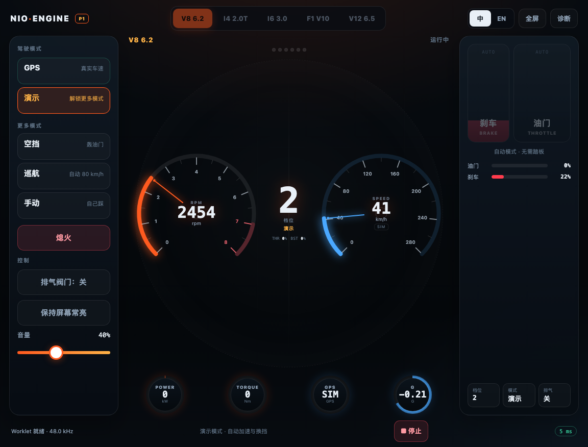
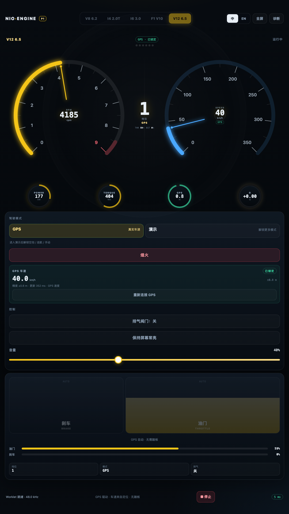
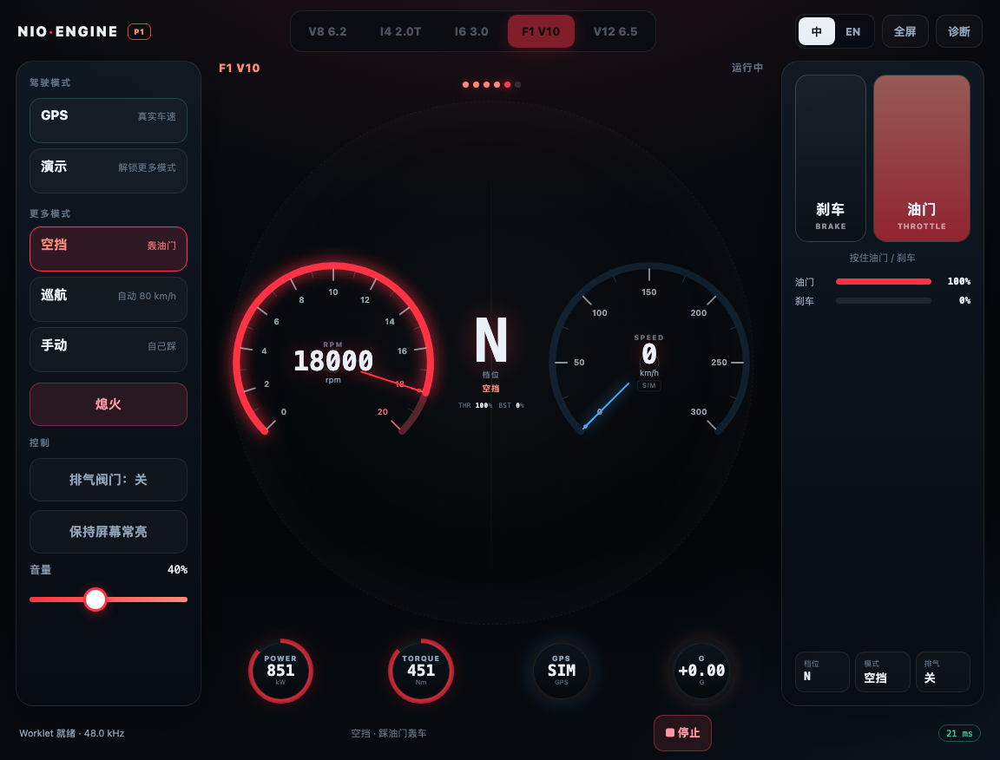
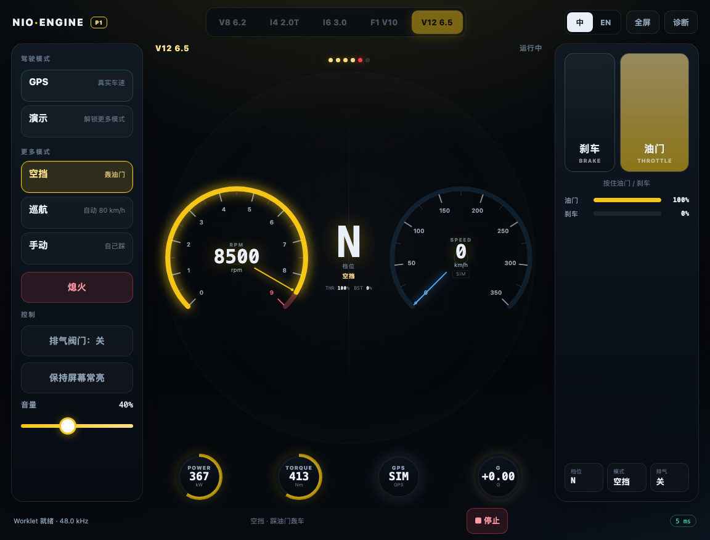

# nioengine P1 · 车机模拟声浪

P1 是面向车机浏览器的**发动机声浪应用**。默认进入 **GPS 驱动**：用真实 GPS 车速 + 速度差分加速度驱动声浪；进入 **演示模式** 后才解锁空挡 / 巡航 / 手动。支持 5 种发动机、自动换挡、涡轮、回火、限转、排气阀门和车厢混响。






> 截图按车机视口 1152 × 876 渲染；实际字体和间距以真车为准。

---

## 快速开始

```bash
npm run build:p1     # 生成 p1/dist/index.html + p1/dist/engine-worklet.js
npm run serve:p1     # http://127.0.0.1:4174
```

P1 版本：`0.6.0`。

### 部署

#### Cloudflare Worker + GitHub

仓库根目录已经包含 `wrangler.jsonc` / `worker.mjs` / `scripts/assemble.mjs`。在 Cloudflare Workers Builds 中连接仓库后：

- Build command：`npm run build:all`
- Deploy command：`npx wrangler deploy`
- Root directory：`/`

部署后 P1 在 `/`，P0 能力探测在 `/p0/`，P2.0 传感器探测在 `/sensors/`。完整配置、自定义域名和排错见 **[docs/cloudflare-worker-deploy.md](../docs/cloudflare-worker-deploy.md)**。

#### 普通静态托管

把这两个文件上传到**同一个 HTTPS 目录**：

```text
/var/www/nioengine-p1/
├── index.html
└── engine-worklet.js
```

- `index.html` 是单文件应用（CSS / JS / Worklet 源码内联）。
- `engine-worklet.js` 是 Blob 加载失败时的同源备用路径，建议一起上传。
- `.js` MIME 必须是 `application/javascript`。
- 必须 HTTPS；非安全上下文下 Worklet 会被浏览器禁用，页面会退化为简单锯齿波。
- P1、P0、P2.0 可以部署在同一个域名下的不同路径（`/`、`/p0/`、`/sensors/`），互不影响。

Nginx 示例：

```nginx
server {
    listen 443 ssl http2;
    server_name your-domain.example.com;
    root /var/www/nioengine-p1;

    location / {
        try_files $uri $uri/ /index.html;
        add_header Cache-Control "no-store";
    }

    location = /engine-worklet.js {
        default_type application/javascript;
        add_header Cache-Control "no-store";
    }
}
```

---

## 启动与操作

打开页面会看到启动页：

1. 选择声浪：**V8 6.2 / I4 2.0T / I6 3.0 / F1 V10 / V12 6.5**。
2. 点 **启动 GPS 声浪**（页面最大的橙色按钮）：起动机 → 点火 → GPS 模式；按提示允许位置权限。
3. 只有想用虚拟驾驶时，才点 **演示模式**。进入演示后会解锁 **空挡 / 巡航 / 手动**，并显示“更多模式”。
4. 停车熄火后，下一次启动会回到默认 **GPS 模式**，其他模式重新隐藏。

> GPS 模式需要 HTTPS 和位置权限。首次进入会弹权限；如果没有弹窗，点 GPS 面板里的“重新连接 GPS”。启动按钮在启动页和熄火后的左侧面板都有脉冲高亮。

驾驶舱：

| 区域 | 操作 |
|---|---|
| 左侧模式 | 默认只有 **GPS**、**演示**；进入演示后显示 **空挡 / 巡航 / 手动** |
| 左侧 GPS 面板 | 定位状态、真实车速、精度、更新间隔、重新连接 |
| 左侧控制 | 排气阀门开/关、屏幕常亮、音量 |
| 中央 | **RPM / 速度双大表**，档位在正中间；换挡灯、四联辅助表 |
| 右侧 | 刹车 / 油门踏板（手动 & 空挡可用），油门/刹车/涡轮条，档位/模式/排气状态 |
| 顶部 | 声浪切换（运行中锁定）、中/英、全屏、诊断 |
| 底部 | 音频状态、模式提示、停止、上报延迟 |

键盘（桌面调试）：`Space` 油门、`B` 刹车、`F` 全屏、`Esc` 停止。

---

## 仪表盘

- **两个大表盘**：左侧 RPM（橙）、右侧 SPEED（蓝），各自带刻度、指针、红线和数字读数。
- **档位在正中间**：大号档位数字 + 模式 + 油门/涡轮百分比；两侧表盘围绕它对称展开。
- **换挡灯**：双表上方的独立灯轨，接近红线时逐颗点亮，最后两颗转红。
- **HUD 光环**：双表背后有低对比圆形光环和垂直中线，把两个表和中间档位连成一个整体。
- **四联辅助表**：
  - `POWER`：由 RPM × 负载 × 扭矩曲线估算的 kW（SIM）；
  - `TORQUE`：估算 Nm（SIM）；
  - `GPS`：定位精度（m）+ 置信度环；
  - `G`：纵向加速度 G 值，加速为暖色、减速为蓝色。
- **模式门控**：默认只显示 GPS / 演示；点演示后展开更多模式，并给出“已解锁”提示。
- **启动按钮**：启动页是整行橙色大按钮，熄火后的左侧启动按钮为 68 px 脉冲高亮。
- **提示**：GPS 信号弱/丢失时，GPS 表环变色，声音按既有策略保持/淡出。

---

## 五种声浪

| 预设 | 结构 | 特征 |
|---|---|---|
| **V8 6.2** | 8 缸十字曲轴，1-8-7-2-6-5-4-3 | 低转轰鸣、二/四阶与半阶、高转怒吼 |
| **I4 2.0T** | 4 缸，1-3-4-2 | 涡轮哨音、收油回火、轻快 |
| **I6 3.0** | 6 缸，1-5-3-6-2-4 | 自吸直六、线性、高转绵密 |
| **F1 V10** | 10 缸 90°，等间隔 72° | 20,000 rpm、无涡轮、高频尖叫、赛车排气 |
| **V12 6.5** | 12 缸，等间隔 60° | Lamborghini 自吸 V12、高转咆哮、十二缸密度 |





运行中不能切换声浪，先“熄火”再换；这是为了避免切换时爆音和参数重置。

---

## 音量与增益

0.4.1 修正了车机上的整体音量偏小问题；0.5.0 / 0.6.0 保留该增益与软限幅：

```text
Worklet → EQ → 压缩 → master（音量 × 2.2）→ 软限幅 → analyser → 扬声器
```

- 100% 音量时输出接近满刻度（实测峰值约 0.81–0.95，RMS 约 0.40–0.60）；
- 40% 默认音量比 0.4.0 提升约 8 dB；
- 末端是 **0.9 / 0.95 软限幅**，不是重压缩，保留发动机瞬态；
- 如果车机上仍比音乐小，请同时检查车机媒体音源/音量混音；浏览器侧已经接近满输出。

## 声音架构

- **曲轴角点火事件**：每个缸按点火顺序在 720° 循环中触发脉冲，不是简单振荡器。
- **双排气 bank**：左右 bank 独立共振，V8 的 bank 不均匀产生十字曲轴 rumble。
- **排气共振器**：每个 bank 3 个带通共振器 + 时变低通，形成排气音色。
- **进气噪声**：带通白噪声 + 低频 roar，随转速/负载变化。
- **涡轮**：I4 有 boost 哨音和收油 blow-off。
- **回火/爆震**：收油高转时随机 pop；换挡有 cut + pop。
- **限转**：超过 limiter 时断油抖动。
- **起动机/熄火**：起动机 whine + 不规则 crank → catch；熄火 run-down。
- **车厢**：原生 `ConvolverNode`（合成短 IR）+ EQ + 压缩/限幅。
- **排气阀门**：改变亮度/输出，作为音色开关。

---

## 虚拟驾驶

浏览器拿不到车速/转速/油门，所以 P1 的“行驶”是页面内的虚拟驾驶：

- 自动变速箱：根据转速、油门、车速换挡；轻油早换、全油高转换。
- 巡航：PI 控制目标 80 km/h。
- 演示：32 秒循环，0 → 60 → 130 → 100 → 50 → 0 km/h。
- 手动：按住油门/刹车，自动换挡；空挡可原地轰油门。
- 空挡带速：车速滑行，发动机回到怠速/油门转速。

**虚拟模式的车速只用于声浪体验**，不代表真实车辆状态。

---

## GPS 驱动（P2.1）

P2.0 真车日志（`p2run.log`）的结论：

- GPS 可用：2 Hz、2014 个样本、速度无缺失、精度中位 0.68 m；
- IMU 不可用：DeviceMotion / Orientation 只有全 null 事件，Generic Sensor 全部连接失败；
- 因此 P1 不做 GPS+IMU 融合，采用 **GPS-only**。

### 数据流

```text
Geolocation.watchPosition (约 2 Hz)
  → coords.speed（真实地面速度）
  → 1 s / 2 s 速度差分（加速度）
  → 虚拟变速箱（档位 / RPM）
  → 负载 / 回火 / 涡轮
  → P1 Engine Worklet
```

- 速度 → 档位和 RPM：100 km/h 约 3 挡 / 4000 rpm（V8），不同声浪使用自己的齿比；
- 正加速度 → 油门/负载；负加速度 → 收油/发动机制动/回火；
- 换挡：速度阈值 + 加速度修正 + 迟滞；换挡时 cut + pop；
- 停车：怠速；低于 0.6 km/h 不进入行驶负载；
- 没有真实档位、转速、油门或 CAN 数据，档位/RPM 是虚拟映射。

### 丢星与后台

- 前台运行时，GPS 超过 2 s 没更新 → 显示“信号弱”，停止新增负载；
- 前台运行超过 5 s → 声音逐渐淡出到怠速；
- 页面 hidden 时浏览器会暂停 GPS；hidden 期间声音保持最后状态，回到前台后重新定位并平滑恢复/淡出；
- 不使用 IMU 推算，所以长隧道只能保持/淡出，不能补速度。

### 延迟

GPS 约 2 Hz，加速度用 1–2 s 窗口，叠加 P1 的约 98 ms 音频输出延迟：

- 巡航/缓加速：速度和音高匹配良好；
- 急加速/收油：负载会比真实油门慢约 **1–2 s**；
- 瞬时“踩下就轰”做不到；这是 GPS-only 的上限。

### GPS 测试

1. 打开 P1，点 **启动 GPS 声浪**，允许位置权限；
2. 确认左侧 GPS 面板出现“已锁定”、精度和更新间隔；
3. 行驶 0 / 30 / 60 / 100 km/h，观察档位、RPM、负载；
4. 做几次急加速、急刹；确认收油回火和换挡；
5. 切到后台再回来，确认 GPS 恢复、声音平滑；
6. 进隧道/地库，确认显示“信号丢失”且声音淡出，不爆音。

> 不要在看屏幕时驾驶；由乘客操作或停车设置。

---

## 诊断

右上角 **诊断** 打开抽屉，显示：

- Worklet 状态 / 加载方式（blob/url）/ HTTPS 阻止
- AudioContext 状态、采样率
- 浏览器上报的 base/output 延迟
- 心跳次数、最近间隔、最大间隔
- FPS、发动机状态、声浪、模式、车速、档位
- GPS 状态、GPS 速度/精度、1 s/2 s 加速度、数据年龄、点数、置信度
- 可复制诊断 JSON

开发参数：

- `?autostart=demo` / `?autostart=cruise` / `?autostart=manual` / `?autostart=gps` / `?autostart=1`
- `?lang=zh` / `?lang=en`
- 控制台 `window.__P1__` 可读状态、启动/停止、切模式/声浪、看频谱。
- 调试注入 GPS：`window.__P1__.injectGps({ speedMps: 16.7, accuracyMps: 0.8 })`（不会请求定位，仅用于离线测试）。

---

## 已知限制

- **输出延迟约 98 ms**（P0 真车上报 10 + 88 ms）。P1 用连续虚拟驾驶和转速平滑弱化，但瞬时“踩下就轰”仍会略慢；这是车机音频 HAL 决定的，Worklet 不能降低。
- **GPS-only 有约 1–2 s 负载滞后**：GPS 2 Hz + 1–2 s 差分；速度/巡航匹配好，急加速/收油会慢。没有 IMU，无法补瞬态。
- **不是真实 CAN/OBD 联动**：GPS 只提供地面速度；档位/RPM/负载仍为虚拟映射。真实转速/档位需要原生/OEM（本项目不做）。
- **GPS 会受权限、隧道、地库、页面 hidden 影响**；丢失时保持/淡出，不做 IMU 推算。
- **没有手动换挡**：P1 只做自动变速箱；手动拨片留到后续。
- **工作声浪是合成模型**，需要在真车上按听感继续调音；频谱结构对，但音色、音量、低频/ANC 表现要实车确认。
- **Worklet 不可用时**会退化为简单锯齿波，只保证有声音；完整声浪需要 HTTPS + Worklet。
- **GPS 数据目前最高验证到 61.6 km/h**（P2 首轮），100 km/h 以上和隧道策略还需真车补充。
- 未做完整的 10 分钟自动稳定性报告；可以长按演示/巡航跑，配合诊断面板观察心跳与 FPS，或继续用 P0 做长稳测试。

---

## 真车测试清单

1. 打开 HTTPS 页面，确认启动页和三个声浪卡片正常；试听 V8 / I4 / I6。
2. 启动后先空挡轰油门，确认怠速、拉转、收油回火。
3. **巡航**：自动加速到 80 km/h，观察换挡和转速；**演示**：完整看 32 秒循环。
4. **手动**：按住油门/刹车，确认加速、自动升挡、刹车降挡、停车。
5. **GPS**：允许定位，确认 GPS 面板“已锁定”；行驶 0/30/60/100 km/h，观察档位/RPM、急加速负载、急刹回火、换挡；切后台再回来，确认恢复；进隧道/地库，确认淡出无爆音。
6. 试排气阀门、音量、全屏、屏幕常亮。
7. 旋转横竖屏，确认布局与可读性。
8. 长跑 10 分钟，观察诊断里的心跳、最大间隔、FPS；记录任何断音/爆音。
9. 用手机录一段车内视频（V8 怠速/拉转、I4 涡轮、I6 高转、GPS 加速/刹车、演示换挡），回传做调音依据。

---

## 文件

```text
p1/
├── index.html          页面结构
├── styles.css          车机 cockpit UI
├── i18n.js             中 / 英
├── app.js              虚拟驾驶 / GPS 驱动、UI、音频图、诊断
├── engine-worklet.js   发动机合成 Worklet
├── build.mjs           内联构建
├── docs/               截图
└── dist/               构建产物（gitignore）
```

P0 能力探测仍在仓库根目录，保留用于 HTTPS/Worklet/延迟/长稳诊断。
